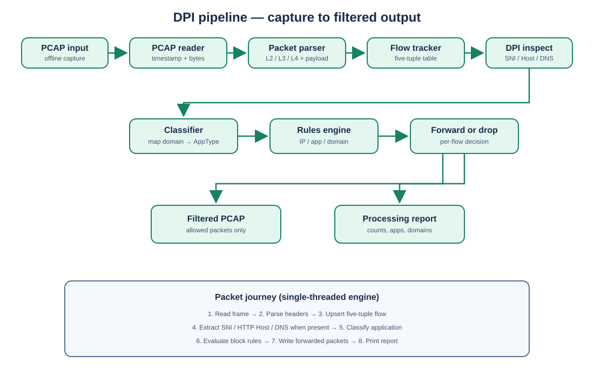
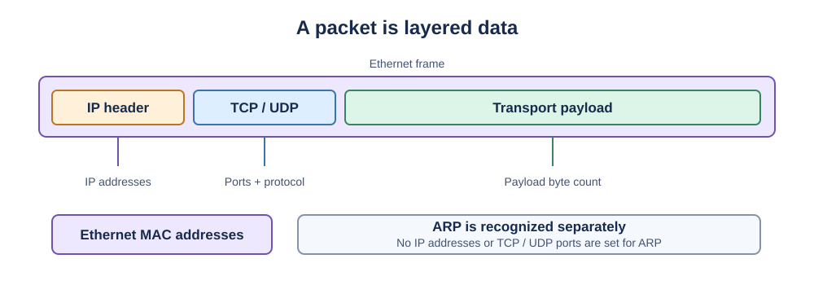
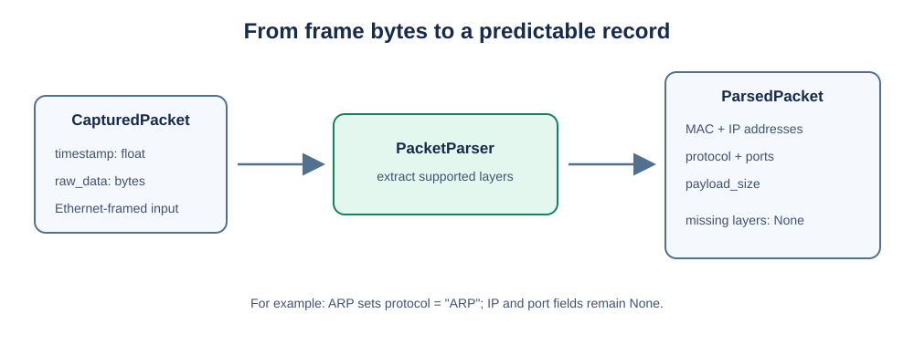

# Deep Packet Inspection

A Python learning project for reading packet captures and extracting useful network metadata. The current implementation reads a PCAP file and parses Ethernet-framed packets into normalized records. Flow tracking, application-layer inspection, filtering, and reporting are planned, but are not implemented yet.

> **Status:** Early development. Offline PCAP reading and basic packet parsing are available; the broader DPI pipeline is a roadmap.

## How packet analysis flows

The solid path below is implemented. Dashed stages show the intended direction of development, not current features.



### 1. Read a capture

`PcapFileReader` iterates through a capture instead of loading all packets into memory at once. Each `CapturedPacket` contains a timestamp and serialized packet bytes.

### 2. Parse a packet

`PacketParser` currently expects Ethernet-framed bytes. It extracts link, network, and transport metadata for supported Ethernet, IPv4, IPv6, TCP, UDP, and ARP packets.



### 3. Use normalized metadata

The parser returns a `ParsedPacket` record with nullable fields where a layer is not present. For example, an ARP packet has no IP addresses or TCP/UDP ports.



## Current features

- Incremental offline reading through Scapy's `PcapReader`.
- Immutable `CapturedPacket` records with timestamp and packet bytes.
- Ethernet source and destination MAC address extraction.
- IPv4 and IPv6 source and destination address extraction.
- TCP or UDP protocol and port extraction, plus transport payload size.
- ARP recognition.
- Unit tests for PCAP reading and supported packet parsing.

## Quick start

### Requirements

- Python 3.12 or newer
- [uv](https://docs.astral.sh/uv/)
- A PCAP file readable by Scapy. The current parser expects Ethernet-framed packets.

### Install

From the repository root, synchronize the environment:

```cmd
uv sync
```

### Analyze a capture

The reader and parser can be used directly from Python:

```python
from deep_packet_inspection.capture.pcap_reader import PcapFileReader
from deep_packet_inspection.parser.packet_parser import PacketParser

parser = PacketParser()

for captured in PcapFileReader("path/to/capture.pcap"):
    packet = parser.parse(captured.timestamp, captured.raw_data)
    print(
        packet.protocol,
        packet.src_ip,
        packet.src_port,
        "->",
        packet.dst_ip,
        packet.dst_port,
    )
```

This prints metadata only; it does not identify applications, inspect TLS SNI, or apply filtering rules.

## Data records

### `CapturedPacket`

Produced by `PcapFileReader`:

| Field | Type | Meaning |
|---|---|---|
| `timestamp` | `float` | Capture timestamp |
| `raw_data` | `bytes` | Serialized packet bytes |

### `ParsedPacket`

Produced by `PacketParser.parse(timestamp, raw_data)`:

| Field | Type | Meaning |
|---|---|---|
| `timestamp` | `float` | Capture timestamp |
| `src_mac`, `dst_mac` | `str \| None` | Ethernet source and destination addresses |
| `src_ip`, `dst_ip` | `str \| None` | IPv4 or IPv6 source and destination addresses |
| `protocol` | `str` | `TCP`, `UDP`, `ARP`, or `OTHER` |
| `src_port`, `dst_port` | `int \| None` | TCP or UDP source and destination ports |
| `payload_size` | `int` | Number of bytes beneath the TCP or UDP layer, or zero when not extracted |

## Roadmap

1. Complete and broaden packet parser validation.
2. Track bidirectional network flows.
3. Extract supported application metadata, such as TLS SNI when visible.
4. Classify traffic using protocol and application metadata.
5. Add configurable rules and a processing engine.
6. Write selected packets to a filtered PCAP.
7. Generate packet, protocol, and flow reports.
8. Profile and optimize where measurements show a need.
9. Consider optional live capture after the offline pipeline is stable.

The planned end-to-end design is shown below. Only the reader and parser stages are currently implemented.


## Development

Run the test suite:

```cmd
uv run pytest -v
```

Run lint:

```cmd
uv run ruff check src tests
```

Run tests with coverage:

```cmd
uv run pytest --cov=deep_packet_inspection --cov-report=term-missing
```

The project uses Python, [Scapy](https://scapy.net/), [pytest](https://docs.pytest.org/), [Ruff](https://docs.astral.sh/ruff/), and [uv](https://docs.astral.sh/uv/). Pydantic, Typer, and structlog are declared dependencies for planned or evolving functionality.

## Repository layout

```text
deep_packet_inspection/
├── docs/
│   └── images/                  # README diagrams
├── src/deep_packet_inspection/
│   ├── capture/
│   │   └── pcap_reader.py
│   └── parser/
│       └── packet_parser.py
├── tests/
│   ├── test_packet_parser.py
│   └── test_pcap_reader.py
├── pyproject.toml
└── README.md
```

## Current limitations

- The parser decodes input with `Ether(raw_data)` and does not explicitly support non-Ethernet link-layer formats.
- This is a basic metadata parser, not a complete protocol dissector or intrusion-detection system.
- Application identification, TLS SNI extraction, flow tracking, classification, filtering, and reporting are not implemented.
- Port numbers alone do not reliably identify an application.
- Live capture is not implemented; future live capture may require platform-specific drivers and permissions.
- Existing tests use synthetic packet data; validation against a wider range of real-world captures remains future work.

## Responsible use

Only analyze captures that you own or are authorized to inspect. Packet captures can contain sensitive data, including credentials, personal information, browsing metadata, and internal network details. Protect capture files and reports, and share packet contents only when necessary.

## License

No project license has been selected. Until a license is added, reuse, modification, and distribution permissions are not explicitly granted.
