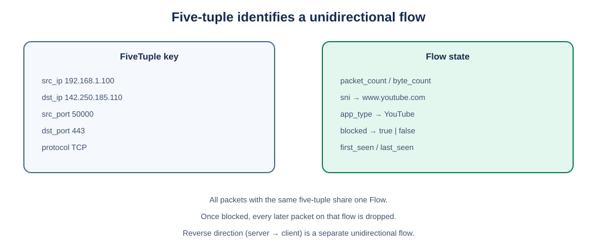
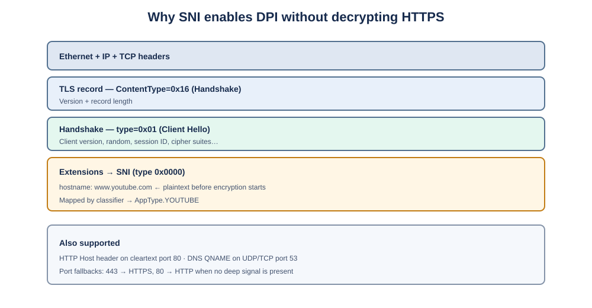
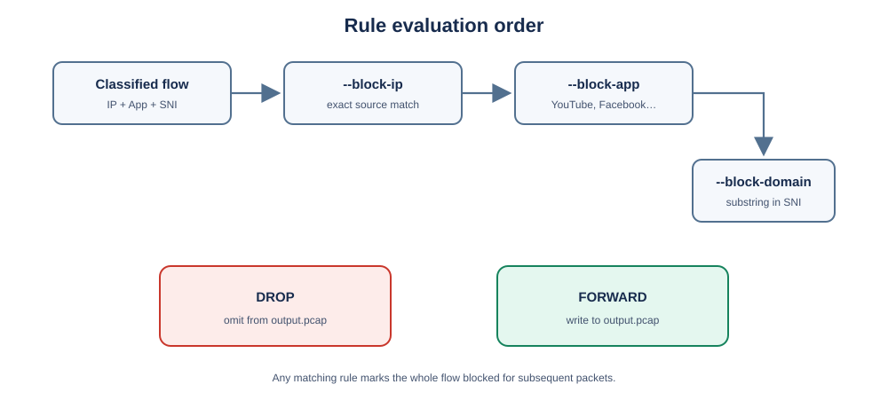
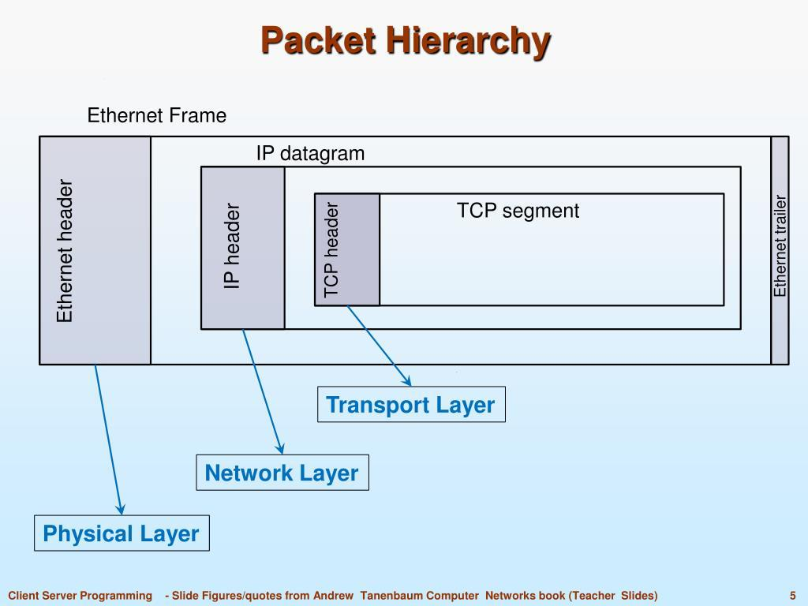
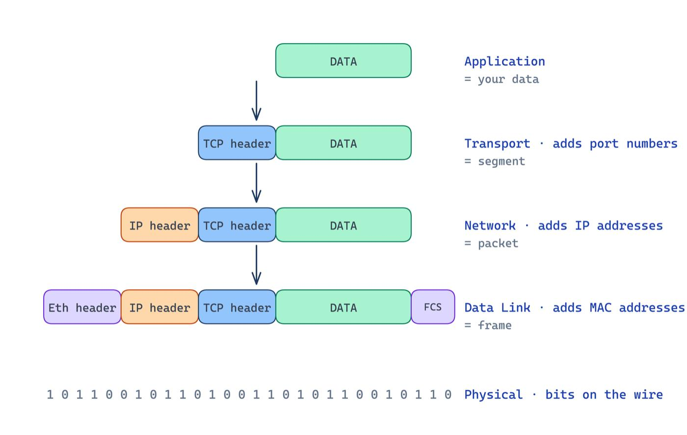

# Deep Packet Inspection

Python remake of [perryvegehan/Packet_analyzer](https://github.com/perryvegehan/Packet_analyzer): an offline DPI engine that reads a PCAP, parses packets, tracks flows, extracts TLS SNI / HTTP Host / DNS names, classifies applications, applies block rules, writes a filtered PCAP, and prints a processing report.

> **Status:** Complete single-threaded offline pipeline (reader → parser → flows → DPI → rules → writer → report). Multi-threaded load-balancer / fast-path workers from the C++ project are intentionally out of scope for this learning remake.

---

## What it does

```text
User traffic (PCAP) → [DPI Engine] → Filtered traffic (PCAP)
                           ↓
                    - Identifies apps (YouTube, Facebook, GitHub, …)
                    - Blocks by IP / app / domain
                    - Generates a processing report
```

| Capability | Status |
|---|---|
| Streaming PCAP read | Done |
| Ethernet / IPv4 / IPv6 / TCP / UDP / ARP parse | Done |
| Five-tuple flow tracking | Done |
| TLS SNI extraction | Done |
| HTTP Host extraction | Done |
| DNS query name extraction | Done |
| Application classification | Done |
| Block rules (IP / app / domain) | Done |
| Filtered PCAP output | Done |
| CLI + processing report | Done |
| Multi-threaded LB / FP pipeline | Not in this remake |

---

## Architecture


### Packet journey

1. **Read** — `PcapFileReader` streams frames (timestamp + bytes).
2. **Parse** — `PacketParser` extracts L2/L3/L4 metadata and transport payload.
3. **Track** — `FlowTracker` upserts a unidirectional five-tuple `Flow`.
4. **Inspect** — TLS SNI, HTTP Host, or DNS QNAME when visible in the payload.
5. **Classify** — map domain → `AppType` (with port fallbacks).
6. **Filter** — `RuleManager` marks flows blocked by IP / app / domain.
7. **Write** — allowed packets go to the output PCAP.
8. **Report** — packet / flow / application breakdown.







Additional layering diagrams:





---

## Quick start

### Requirements

- Python **3.12+**
- [uv](https://docs.astral.sh/uv/)

### Install

```cmd
uv sync
```

### Generate a demo capture

```cmd
uv run python scripts/generate_test_pcap.py -o test_dpi.pcap
```

### Analyze and filter

```cmd
uv run dpi test_dpi.pcap output.pcap --block-app YouTube --block-ip 192.168.1.50
```

Equivalent entry points:

```cmd
uv run deep-packet-inspection test_dpi.pcap output.pcap --block-domain facebook
uv run python -m deep_packet_inspection test_dpi.pcap output.pcap
```

### Example report (from the demo capture)

```text
╔══════════════════════════════════════════════════════════════╗
║              DPI ENGINE — Deep Packet Inspection             ║
╚══════════════════════════════════════════════════════════════╝

[Rules] Blocked IP: 192.168.1.50
[Rules] Blocked app: YouTube
[DPI] Processing packets...
[BLOCKED] 192.168.1.100 -> 142.250.185.110 (YOUTUBE: www.youtube.com)
[BLOCKED] 192.168.1.50 -> 1.1.1.1 (HTTPS)

╔══════════════════════════════════════════════════════════════╗
║                    PROCESSING REPORT                         ║
╠══════════════════════════════════════════════════════════════╣
║  Total Packets:           7                                  ║
║  Forwarded:               5                                  ║
║  Dropped:                 2                                  ║
║  Active Flows:            7                                  ║
╠══════════════════════════════════════════════════════════════╣
║                  APPLICATION BREAKDOWN                       ║
╠══════════════════════════════════════════════════════════════╣
║  HTTPS                 3   42.9%                             ║
║  YouTube               1   14.3%                             ║
║  Facebook              1   14.3%                             ║
║  GitHub                1   14.3%                             ║
║  DNS                   1   14.3%                             ║
╚══════════════════════════════════════════════════════════════╝

[Detected Applications/Domains]
  - example.com -> HTTPS
  - github.com -> GitHub
  - www.example.com -> HTTPS
  - www.facebook.com -> Facebook
  - www.google.com -> DNS
  - www.youtube.com -> YouTube
```

---

## Library usage

```python
from deep_packet_inspection.engine import DpiEngine
from deep_packet_inspection.rules import RuleManager

rules = RuleManager()
rules.block_app("YouTube")
rules.block_ip("192.168.1.50")
rules.block_domain("facebook")

engine = DpiEngine(rules=rules)
stats = engine.process("input.pcap", "filtered.pcap")
print(stats.total_packets, stats.forwarded_packets, stats.dropped_packets)
```

Lower-level building blocks:

```python
from deep_packet_inspection.capture import PcapFileReader
from deep_packet_inspection.parser import PacketParser

parser = PacketParser()
for captured in PcapFileReader("capture.pcap"):
    packet = parser.parse(captured.timestamp, captured.raw_data)
    print(packet.protocol, packet.src_ip, packet.dst_ip, packet.payload_size)
```

---

## Repository layout

```text
deep_packet_inspection/
├── docs/images/                 # Architecture diagrams (SVG)
├── scripts/
│   └── generate_test_pcap.py    # Demo multi-protocol PCAP generator
├── src/deep_packet_inspection/
│   ├── capture/                 # PCAP reader + writer
│   ├── parser/                  # L2/L3/L4 metadata + payload
│   ├── flow/                    # FiveTuple, Flow, FlowTracker, AppType
│   ├── inspection/              # SNI, HTTP Host, DNS, classifier
│   ├── rules/                   # Block IP / app / domain
│   ├── engine/                  # Pipeline + report formatter
│   ├── util/                    # Synthetic TLS/DNS builders
│   └── cli.py                   # Typer CLI (`dpi`)
├── tests/                       # Unit + integration tests
├── pyproject.toml
└── README.md
```

---

## Test results

All automated tests were run on **Windows / Python 3.12.16** with `pytest` + `pytest-cov`.

```cmd
uv run pytest -v --cov=deep_packet_inspection --cov-report=term-missing
uv run ruff check src tests
```

### Summary

| Metric | Result |
|---|---|
| Tests collected | **25** |
| Passed | **25** |
| Failed | **0** |
| Line coverage | **~91%** |
| Ruff lint | **All checks passed** |

### Suite breakdown

| Module | What it covers | Cases |
|---|---|---|
| `test_pcap_reader.py` | Streaming read, missing/invalid/empty files | 4 |
| `test_packet_parser.py` | TCP / UDP / ARP / IPv6 parse + payload | 4 |
| `test_flow_tracker.py` | Five-tuple aggregation, reverse flows, ARP skip | 3 |
| `test_inspection.py` | SNI, HTTP Host, DNS, app mapping | 6 |
| `test_rules.py` | IP / app / domain blocks + unknown app | 4 |
| `test_engine.py` | End-to-end classify, report, filtering | 2 |
| `test_cli.py` | Typer CLI success + missing input | 2 |

### Latest pytest output (abbreviated)

```text
============================= test session starts =============================
platform win32 -- Python 3.12.16, pytest-9.2.0
collected 25 items

tests/test_cli.py ...................... PASSED
tests/test_engine.py ................... PASSED
tests/test_flow_tracker.py ............. PASSED
tests/test_inspection.py ............... PASSED
tests/test_packet_parser.py ............ PASSED
tests/test_pcap_reader.py .............. PASSED
tests/test_rules.py .................... PASSED

TOTAL coverage ~91%
============================= 25 passed in 0.87s ==============================
```

---

## Development

```cmd
uv sync
uv run pytest -v
uv run pytest --cov=deep_packet_inspection --cov-report=term-missing
uv run ruff check src tests
```

Stack: Python 3.12+, [Scapy](https://scapy.net/), [Typer](https://typer.tiangolo.com/), [pytest](https://docs.pytest.org/), [Ruff](https://docs.astral.sh/ruff/), [uv](https://docs.astral.sh/uv/).

---

## Design notes

- **Five-tuple flows are unidirectional** (same as the C++ simple engine). Server→client replies are a separate flow; once a flow is blocked, later packets with that exact tuple are dropped.
- **SNI is plaintext only in the TLS Client Hello.** Encrypted application data is not decrypted.
- **Port fallbacks** mark `:443` as HTTPS and `:80` as HTTP when no deep signal is available.
- **Non-TCP/UDP frames** (for example ARP) are forwarded unchanged because they cannot form a five-tuple.

---

## Limitations

- Ethernet-framed PCAPs only (parser starts from `Ether`).
- No live capture; offline files only.
- No QUIC CRYPTO-frame SNI (optional in the C++ tree; not ported).
- No multi-threaded LB / fast-path architecture.
- Classification is best-effort substring matching on domains — not a commercial DPI signature set.

---

## Responsible use

Only analyze captures you own or are authorized to inspect. Packet captures can contain credentials, personal data, and internal network details. Protect input/output files and share packet contents only when necessary.

---

## License

No project license has been selected yet. Until a license is added, reuse and redistribution terms are not explicitly granted.

Inspired by [perryvegehan/Packet_analyzer](https://github.com/perryvegehan/Packet_analyzer).
